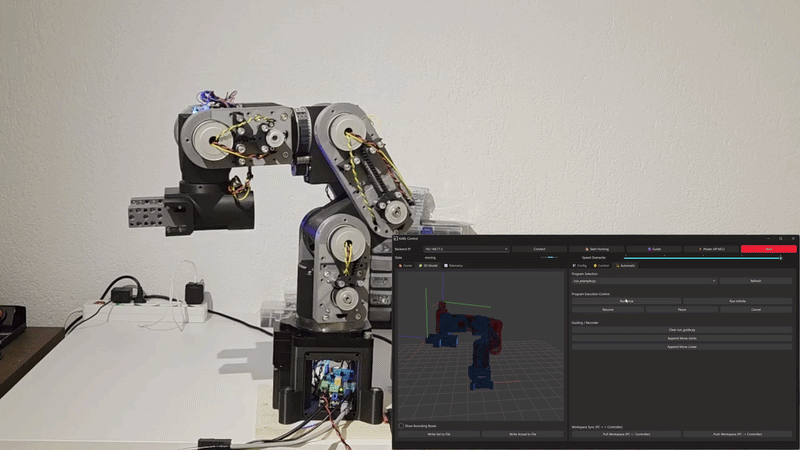

# KARL Robot

[](https://vamechatronics.com)
[](https://www.youtube.com/@vamech)
[](https://karl-robot.readthedocs.io)
[](https://www.python.org/)
[](#)

> Full-stack motion control system, firmware, and Python API for the custom 6-axis KARL robot arm developed
> by [VA-Mechatronics](https://vamechatronics.com).

<!-- start-sphinx-include -->

## System Overview

The **KARL Robotic Control System** provides an end-to-end open-hardware robotics solution.
It connects a Python client API and PySide6 Desktop GUI with a real-time motion controller backend and distributed hardware nodes over CAN.




### Key Highlights

- **Decoupled ZMQ Architecture:** TCP/IP socket connection (`PUSH`, `SUB`, `REQ`) separating high-speed motion planning from client/GUI rendering.
- **Hardware & Simulation Modes:** Full simulation support out of the box without requiring physical hardware connected.
- **Backend Controller (Raspberry Pi):** State machine execution, kinematic handling (DH), 100Hz trajectory generation and motion streaming to the MCUs.
- **Distributed MCU on each axis (custom STM32 Motion Control Untis):** NEMA 17 format, dasy-chained and integrated on each axis. Absolute magnetic encoders and feedback control loop at 1kHz.
- **Expressive Python API:** High-level pythonic API for automated tasks, trajectory interpolation (`moveJ`, `moveL`, `movePoly`), TCP offsets, and skill mixins.

## Quickstart (Simulation Mode)
At this thime you should start with Windows. Linux support is comming soon.
Run the KARL control software and Desktop GUI locally in simulation mode:

### 1. Repository Setup

```bash
# Clone repository
git clone [https://github.com/vamechatronics/KARL-Robot.git](https://github.com/VA-Mechatronics/KARL-Robot.git)
cd KARL-Robot
# Create and activate virtual environment
python -m venv venv
# On Windows:
venv\Scripts\activate
# Install dependencies
pip install -r requirements.txt
# Set root
set PYTHONPATH=.
# Start GUI
python gui\desktop\main.py
# Connect to "Simulation" and try out
```

## Switching to real Robot
### 1. Assembly
   Video Series on [YouTube Channel](https://www.youtube.com/@vamech) comming soon...
   
### 2. Raspberry Pi setup
under work...
1. Clone, generate venv and install requirements

2. Preparing Socket CAN
   ```bash
   # Activate CAN Service
   sudo nano /etc/systemd/system/can0.service
   ```
   ```bash
      [Unit]
      Description=Configure CAN0 interface
      After=network.target
      
      [Service]
      Type=oneshot
      ExecStart=/usr/sbin/ip link set can0 up type can bitrate 500000 dbitrate 2000000 fd on sample-point 0.75 dsample-point 0.75 restart-ms 100
      ExecStop=/usr/sbin/ip link set can0 down
      RemainAfterExit=yes
      
      [Install]
      WantedBy=multi-user.target
   ```
   
   ```bash
   sudo systemctl daemon-reload
   sudo systemctl enable can0.service
   candump can0
   ```

### 3. Firmware flash
   coming soon...
