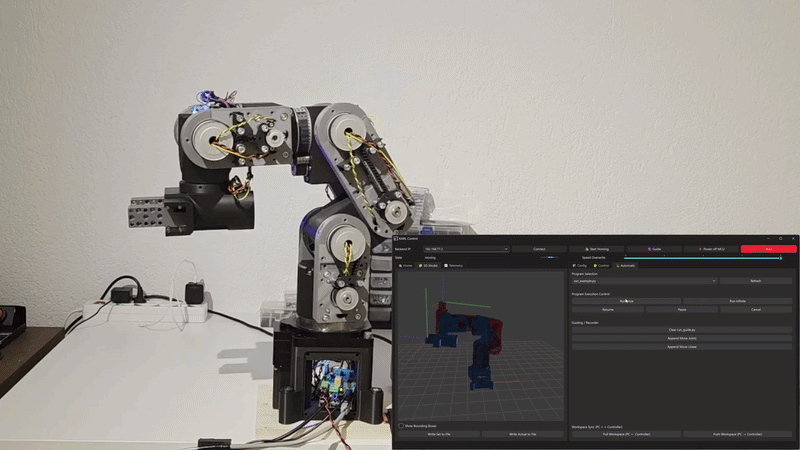

# KARL-Robot

[](https://vamechatronics.com)
[](https://www.youtube.com/@vamech)
[](https://karl-robot.readthedocs.io)
[](https://www.python.org/)
[](#)

> Full-stack motion control system, firmware, and Python API for the custom 6-axis KARL robot arm developed
> by [VA-Mechatronics](https://vamechatronics.com).

<!-- start-sphinx-include -->

## System Overview

The **KARL Robotic Control System** provides an end-to-end open-hardware robotics solution.
It connects a Python client API and PySide6 Desktop GUI with a real-time motion controller backend and distributed hardware nodes over CAN.



### Key Highlights

- **Decoupled ZMQ Architecture:** TCP/IP socket connection (`PUSH`, `SUB`, `REQ`) separating high-speed motion planning from client/GUI rendering.
- **Hardware & Simulation Modes:** Full cross-platform simulation support out of the box without requiring physical hardware.
- **Backend Controller (Raspberry Pi / PC):** State machine execution, kinematic handling (DH), 100 Hz trajectory generation, and motion streaming.
- **Distributed MCUs on Each Axis:** Custom STM32 Motion Control Units (NEMA 17 footprint), daisy-chained via CAN FD. Absolute magnetic encoders and feedback control loops at 1 kHz.
- **Expressive Python API:** High-level pythonic API for automated tasks, trajectory interpolation (`moveJ`, `moveL`, `movePoly`), TCP offsets, and skill mixins.

---

## 1. Initial Repository Setup

Clone the repository and set up a virtual environment on your computer or Raspberry Pi:

```bash
# Clone repository
git clone https://github.com/VA-Mechatronics/KARL-Robot.git
cd KARL-Robot

# Create virtual environment
python -m venv venv

# Activate virtual environment
# On Windows:
venv\Scripts\activate
# On Linux:
source venv/bin/activate

# Install dependencies
pip install -r requirements.txt
```

---
> **Note:** Every newly opened terminal window requires the virtual environment to be activated first (`venv\Scripts\activate` on Windows or `source venv/bin/activate` on Linux).
---

## 2. Running in Simulation Mode
The simulation calculates kinematics, joint trajectories without requiring physical hardware or CAN connections.

### Option A: All-in-One via GUI (Quickest)

Start the Desktop GUI directly. It manages the simulation backend automatically:

```bash
# Windows: venv\Scripts\activate  |  Linux: source venv/bin/activate
python -m gui.desktop.main
```

1. Select `Simulation` in the Backend IP dropdown.
2. Click **Connect**.
3. The GUI will automatically spawn `backend.main_simulation` in a separate terminal window on `localhost` and connect to it.

### Option B: Standalone Simulation Backend

You can run the simulation backend as an independent process, either locally in a second terminal or remotely on any computer in your network.

**1. Terminal 1: Start the simulation backend**
```bash
# On the backend host machine:
# Windows: venv\Scripts\activate  |  Linux: source venv/bin/activate
python -m backend.main_simulation
```

**2. Terminal 2: Start the Desktop GUI**
```bash
# On your workstation:
# Windows: venv\Scripts\activate  |  Linux: source venv/bin/activate
python -m gui.desktop.main
```

* **Running locally:** Select `localhost` and click **Connect**.
* **Running remotely:** Enter the backend host's IP address (e.g., `192.168.1.50`) and click **Connect**.

---

## 3. Python API Installation

You can install the KARL Robot Python API directly into any external Python project without cloning the full controller and GUI codebase.

### Option A: Install directly from GitHub
```bash
pip install git+[https://github.com/VA-Mechatronics/KARL-Robot.git](https://github.com/VA-Mechatronics/KARL-Robot.git)
```

### Option B: Install from a local clone
If you already cloned the repository locally, install the API package from the project root:
```bash
pip install /path/to/KARL-Robot
```

### Quickstart Code Example
```bash
from karl_robot import RobotAPI, RobotConfig, RobotTelemetry, Target, WorkspaceManager

# 1. Setup your own workspace for configs, programs, targets
from pathlib import Path
BASE_PATH = Path(__file__).resolve().parents[0]
ws = WorkspaceManager(BASE_PATH / "workspace")
targets = ws.load_targets()

# 2. Initialize and connect to the robot controller
robot = RobotAPI()
robot.connect(host="localhost")  # or robot IP, e.g. "192.168.1.50"

# 3. Optional subscribe on events
def print_act_tcp(act_target: Target):
    print(f"act_tcp: {act_target.tcp}")
robot.on(event_name="target", callback=print_act_tcp)

# 4. Execute blocking movements
with robot.blocking_mode():
    robot.moveJ(targets["home"], gripper=20.0)
    robot.jog_joint("j6", 50)
```

---

## 4. Running with Physical Hardware

To run the real robot, the Raspberry Pi hardware interface (SocketCAN)
must be configured and running before starting the backend controller.

### Step 1: Raspberry Pi & SocketCAN Setup (Prerequisite)
1. **Clone & Setup Environment:** Follow [1. Initial Repository Setup](#1-initial-repository-setup) on the Raspberry Pi.
2. **Configure the SocketCAN systemd service:**
   ```bash
   sudo nano /etc/systemd/system/can0.service
   ```
   Add the following service configuration:
   ```ini
   [Unit]
   Description=Configure CAN0 interface
   After=network.target

   [Service]
   Type=oneshot
   ExecStart=/usr/sbin/ip link set can0 up type can bitrate 500000 dbitrate 2000000 fd on sample-point 0.75 dsample-point 0.75 restart-ms 100
   ExecStop=/usr/sbin/ip link set can0 down
   RemainAfterExit=yes

   [Install]
   WantedBy=multi-user.target
   ```
3. **Enable and start the CAN service on boot:**
   ```bash
   sudo systemctl daemon-reload
   sudo systemctl enable --now can0.service
   ```
4. **(Optional) Verify CAN traffic:**
   ```bash
   candump can0
   ```

---

### Step 2: Start Hardware Backend & GUI

Once `can0` is active:

**1. On the Raspberry Pi:**
```bash
# In the KARL-Robot directory:
source venv/bin/activate
python -m backend.main
```

**2. On your Desktop Workstation:**
```bash
# In the KARL-Robot directory:
# Windows: venv\Scripts\activate  |  Linux: source venv/bin/activate
python -m gui.desktop.main
```

* In the GUI, enter the Raspberry Pi's IP address (e.g., `192.168.77.2`) in the **Backend IP** dropdown and click **Connect**.

---

## Hardware Assembly & Firmware

* **Mechanical Assembly:** Video Series on [YouTube Channel](https://www.youtube.com/@vamech) coming soon...
* **Firmware Flashing:** MCU flashing instructions and bootloader utilities coming soon...

---


