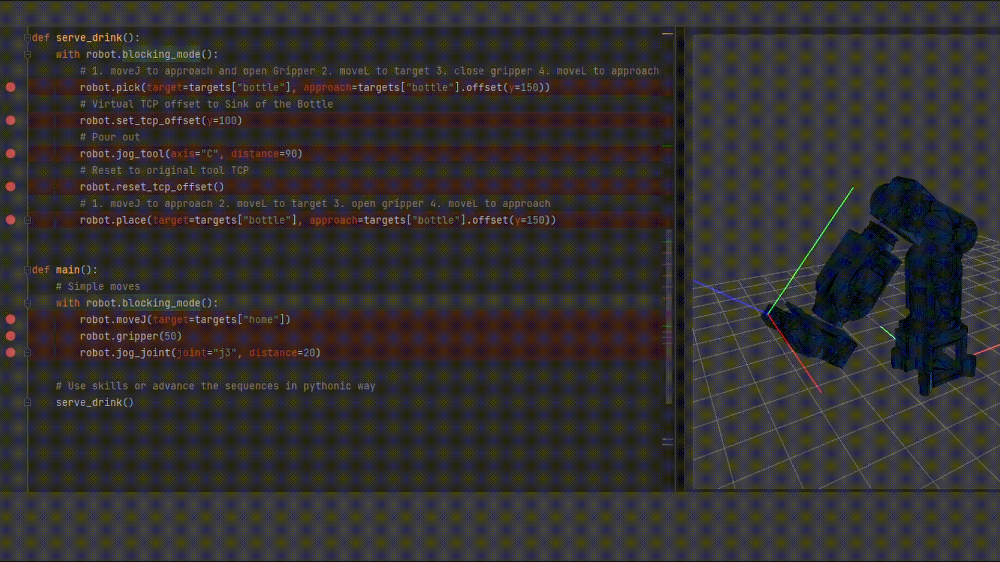

API Reference
=============

Expressive Python API: High-level pythonic API for automated tasks (moveJ, moveL, movePoly), TCP offsets, and skill mixins.

RobotAPI Main Interface
------------------------

.. automodule:: client.client_api
   :members:
   :undoc-members:
   :show-inheritance:

Skill Mixins
------------

Basic Skills
~~~~~~~~~~~~
.. automodule:: client.skills.basic_skills
   :members:
   :undoc-members:
   :show-inheritance:

Homing Skills
~~~~~~~~~~~~~
.. automodule:: client.skills.homing_skills
   :members:
   :undoc-members:
   :show-inheritance:

Program Skills
~~~~~~~~~~~~~~
.. automodule:: client.skills.program_skills
   :members:
   :undoc-members:
   :show-inheritance:

Workspace Skills
~~~~~~~~~~~~~~~~
.. automodule:: client.skills.workspace_skills
   :members:
   :undoc-members:
   :show-inheritance:

Common Data Models & Managers
-----------------------------

Target
~~~~~~
.. automodule:: common.target
   :members:
   :undoc-members:
   :show-inheritance:

RobotConfig
~~~~~~~~~~~
.. automodule:: common.robot_config
   :members:
   :undoc-members:
   :show-inheritance:

RobotTelemetry
~~~~~~~~~~~~~~
.. automodule:: common.mcu_telemetry
   :members:
   :undoc-members:
   :show-inheritance:

WorkspaceManager
~~~~~~~~~~~~~~~~
.. automodule:: common.workspace_manager
   :members:
   :undoc-members:
   :show-inheritance:
